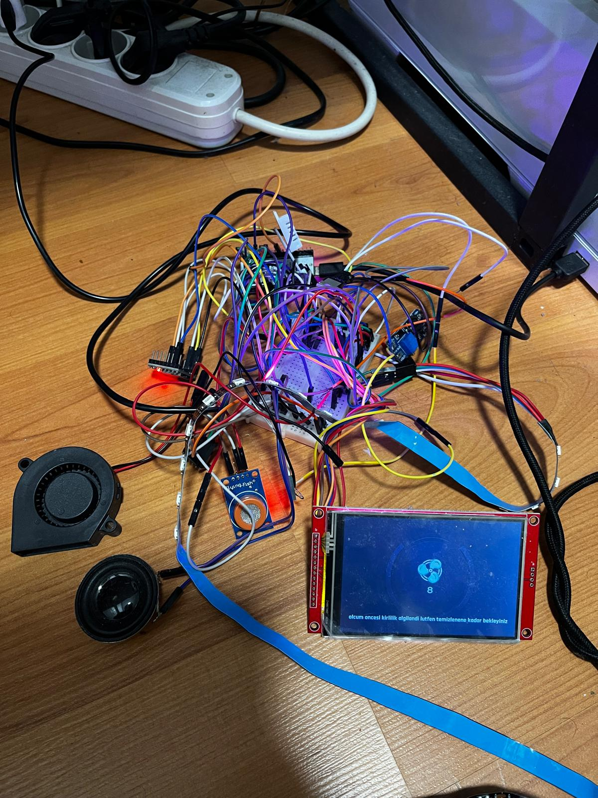
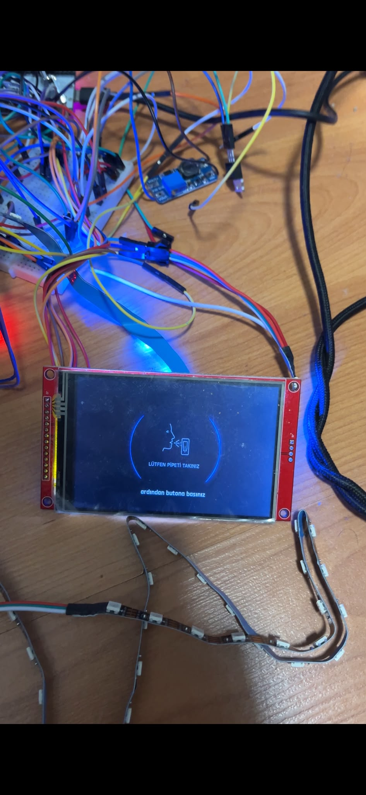
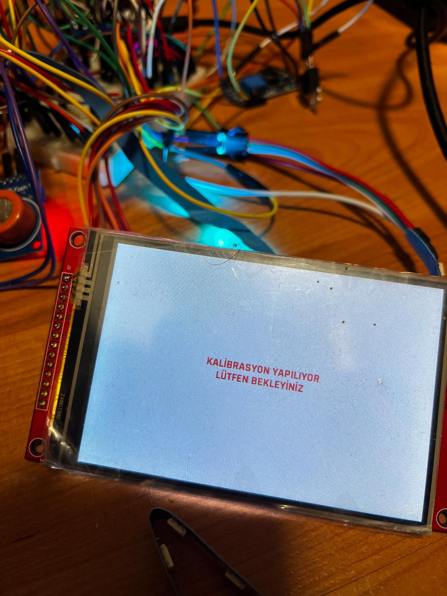
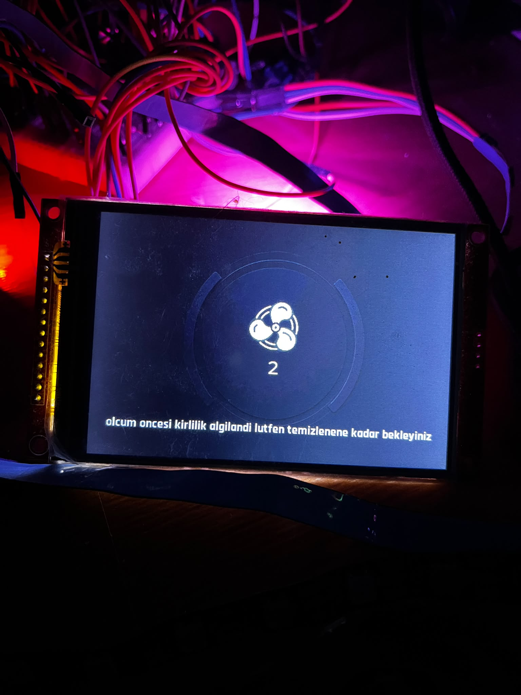
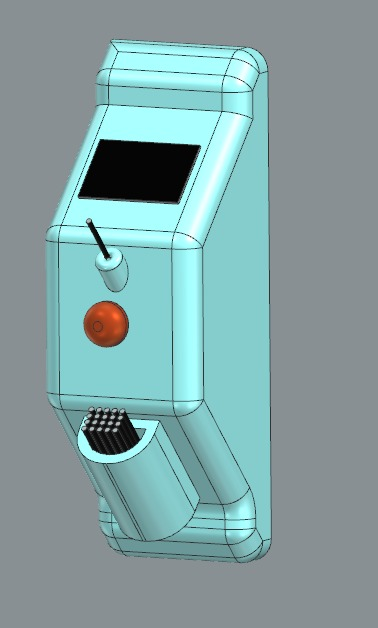

# ESP32 Tabanlı Dijital Alkolmetre

**Türkçe** | [English](README.en.md)

MQ-3 gaz sensörüyle nefesteki alkol yoğunluğunu ölçen, sonucu promil olarak 4" TFT ekranda gösteren, LED halkası ve sesli yönlendirme ile kullanıcıyı adım adım yönlendiren ESP32 tabanlı bir cihaz.

Proje; analog sensör okuma, sıcaklık/nem kompanzasyonu, durum makinesi tabanlı gömülü yazılım, LVGL ile HMI tasarımı ve sistem güvenilirliği (watchdog, kalıcı kalibrasyon, sensör arıza tespiti) konularını bir arada içerir.

<p align="center"></p>

| Ölçüm bekleme | Kalibrasyon | Kanal temizleme |
|---|---|---|
|  |  |  |
| "Lütfen pipeti takınız, ardından butona basınız" | R0 kalibrasyonu sürüyor | Ölçüm öncesi kirlilik algılandı, fan kanalı temizliyor |


https://github.com/user-attachments/assets/cc5a9b4a-1d4b-420c-b947-b24527f48315


---

## Öne Çıkanlar

- **Durum makinesi tabanlı ölçüm akışı:** Bekleme → taban ölçümü → üfleme algılama → 6 sn analiz → sonuç → fanla kanal temizliği
- **Sıcaklık/nem kompanzasyonu:** MQ-3 datasheet grafiğinden sayısallaştırılan Rs/R0 tablosu üzerinde **bilineer interpolasyon**
- **İki sensörlü kanal kirlilik tespiti:** BMP280 basınç sıçraması (ana yöntem), sensör arızalanırsa otomatik olarak MQ-3'ün kendi okumasına geçiş (yedek yöntem)
- **Manuel R0 kalibrasyonu:** Butona 10 sn basılı tutulunca başlar. Fanla temizlik, kararlılık kontrolü ve üfleme algılanırsa iptal adımlarından geçer. Sonuç ESP32'nin **NVS** (kalıcı flash) hafızasına yazılır.
- **Donanım watchdog'u (TWDT):** Kurulumda 10 sn, çalışma sırasında 4 sn zaman aşımı var. Her açılışta bir önceki reset'in nedeni loglanır.
- **Çok kanallı geri bildirim:** LVGL arayüzü, 15 LED'lik WS2812 halka ve DFPlayer Mini ile sesli yönlendirme (sonucu sesli okuma dahil)
- **Bloklamayan mimari:** Sensör (100 ms) ve LED animasyonu (30 ms) birbirinden bağımsız LVGL timer'larında çalışır. Ses kuyruğu `loop()` içinde servis edilir.

---

## Donanım

| Bileşen | Görev |
|---|---|
| ESP32 | Ana kontrolcü |
| MQ-3 alkol sensör modülü | Nefesteki alkol ölçümü (analog çıkış, modül üzerinde RL = 200 kΩ) |
| 4" IPS TFT ekran, ST7796, 480×320, SPI | LVGL arayüzü |
| Gerilim bölücü (10 kΩ / 15 kΩ) | 5 V sensör çıkışını ESP32'nin 3,3 V ADC aralığına indirir |
| BMP280 (I2C) | Nefes kanalında basınç ölçümü: üfleme ve kanal kirliliği tespiti |
| DHT22 | Ortam sıcaklık/nem ölçümü: MQ-3 kompanzasyonu için |
| WS2812 LED halka (15 LED) | Durum göstergesi (bekleme, üfleme dolum animasyonu, sonuç rengi…) |
| DFPlayer Mini + hoparlör | Sesli yönlendirme ve sonuç anonsu |
| Fan + MOSFET | Ölçüm sonrası ve kirlilik durumunda nefes kanalını temizler |
| Buton | Ölçüm başlatma / 10 sn basılı tutma ile R0 kalibrasyonu |

### Pin bağlantıları

| Sinyal | ESP32 pini |
|---|---|
| MQ-3 A0 (gerilim bölücü üzerinden) | GPIO34 (ADC1) |
| TFT MOSI / MISO / SCLK | GPIO23 / GPIO19 / GPIO18 |
| TFT CS / DC / RST | GPIO15 / GPIO2 / GPIO4 |
| BMP280 SDA / SCL (adres 0x76, yedek 0x77) | GPIO21 / GPIO22 |
| DHT22 | GPIO32 |
| WS2812 veri | GPIO33 |
| DFPlayer TX → ESP32 RX / DFPlayer RX → ESP32 TX (UART2, 9600 baud) | GPIO16 / GPIO17 |
| Fan (MOSFET kapısı) | GPIO26 |
| Buton (dahili pull-up) | GPIO27 |

> GPIO4 ekranın RST pini olarak kullanıldığı için nefes sensörü tek hatlı DHT yerine I2C üzerinden bağlanan BMP280 olarak seçildi.

<!-- Devre şeması varsa:  -->

---

## Çalışma Prensibi

### 1. Sensör direncinin ölçülmesi

ADC, `ADC_11db` zayıflatma ile `analogReadMilliVolts()` kullanılarak okunur. Gürültüyü azaltmak için her ölçümde 20 örneğin ortalaması alınır (oversampling). Pin gerilimi, gerilim bölücü oranıyla (`(10k+15k)/15k ≈ 1,667`) gerçek sensör gerilimine çevrilir ve sensör direnci hesaplanır:

```
Rs = (Vcc × RL / Vsensör) − RL        (Vcc = 5 V, RL = 200 kΩ)
```

### 2. Sıcaklık/nem kompanzasyonu

MOS tipi sensörlerin direnci ortam sıcaklığı ve nemine bağlı olarak değişir. MQ-3 datasheet'indeki "Rs/R0 – sıcaklık/nem" grafiği sayısallaştırıldı: 3 nem eğrisi (%30, %60, %85 RH) ve her eğride −10 °C ile 50 °C arasında 13 nokta var. Ölçüm anındaki DHT22 değerleri bu tabloda önce sıcaklık, sonra nem ekseninde **bilineer interpolasyonla** aranır. Elde edilen katsayı, kalibrasyon anındaki referans koşulla oranlanarak `Rs/R0` düzeltilir.

### 3. Alkol yoğunluğu ve promil

Düzeltilmiş oran, MQ-3 datasheet'indeki "Alcohol" eğrisine uydurulan güç fonksiyonuyla mg/L'ye çevrilir. Ardından nefes/kan alkolü arasındaki yaklaşık 2100:1 oran kullanılarak promile dönüştürülür:

```
mg/L   = a × (Rs/R0)^(−1,4941)
promil ≈ mg/L × 2,1
```

### 4. Ölçüm durum makinesi

```
 ┌────────┐ buton  ┌───────────┐       ┌──────────────────────────┐       ┌────────┐       ┌───────────────┐
 │ BEKLE  │──────▶│ TABAN_OLC │──────▶│ OLCUM                    │──────▶│ SONUC  │──────▶│ KANAL_TEMIZLE │──┐
 └────────┘       └───────────┘       │ üfleme bekle → 6 sn analiz│       │ + fan  │       │ fan 10 sn     │  │
   ▲   │                              └──────────────────────────┘       └────────┘       └───────────────┘  │
   │   │ 10 sn basılı tut                                                                                     │
   │   ▼                                                                                                      │
   │ ┌────────────────┐                                                                                       │
   │ │ R0_KALIBRASYON │  purge (fan 30 sn) → bekleme → kararlılık örneklemesi → NVS'ye kaydet                 │
   │ └────────────────┘                                                                                       │
   └──────────────────────────────────────────────────────────────────────────────────────────────────────────┘
```

- **TABAN_OLC:** Her ölçümden önce taban değer yeniden ölçülür (~1,5 sn).
- **OLCUM:** Üfleme, BMP280'deki basınç sıçramasıyla algılanır. BMP280 arızalıysa MQ-3 eşiği kullanılır. Algılamadan sonra 6 sn'lik analiz penceresi başlar. Sonuç olarak **tepe değer (peak-hold)** kullanılır ve bir okumanın sayılması için eşiği **3 ardışık okumada** geçmesi gerekir. Böylece tek seferlik gürültü sonuca yansımaz.
- **SONUC:** Promil ekranda gösterilir ve sesli okunur. 0,50 ‰ ve üzeri kırmızı uyarı olarak gösterilir. Bu sırada fan çalışır.
- **KANAL_TEMIZLE:** Kanalda kalıntı ya da izinsiz üfleme algılanırsa ölçüm engellenir ve fan sabit süre çalışır.

### 5. Kanal kirlilik tespiti ve sensör arıza yönetimi

- **Ana yöntem:** BMP280'in anlık basıncı kendi yavaş EMA ortalamasıyla karşılaştırılır. Sapma eşiği aşarsa kanal "kirli" sayılır.
- **Arıza tespiti:** Sensör I2C'de bulunamazsa, 10 dakika boyunca değeri hiç değişmezse ("donmuş" okuma) ya da fiziksel olarak imkânsız bir basınç değeri okursa arızalı kabul edilir.
- **Yedek yöntem:** Arıza durumunda sistem otomatik olarak MQ-3'ün kendi ham okumasıyla kirlilik tespitine geçer. Bu yedek sayaç, gerçek üflemeyi kirlilik sanmaması için ölçüm sırasında çalışmaz.

### 6. Güvenilirlik

- **Task Watchdog:** `setup()` ve `loop()` aynı FreeRTOS görevinde çalışır. Tüm bloklayan döngülere besleme noktaları eklendi. Kilitlenme olursa cihaz kendini resetler. Detaylar: [`ui/Watchdog/WATCHDOG_ENTEGRASYONU.md`](ui/Watchdog/WATCHDOG_ENTEGRASYONU.md)
- **NVS:** R0, kalibrasyon referans sıcaklık/nem değerleri ve ölçüm sayacı kalıcı olarak saklanır. Flash yazma işlemi yavaş olabildiği için öncesinde ve sonrasında watchdog beslenir.

---

## Yazılım

- Arduino IDE / ESP32 Arduino Core
- [LVGL](https://lvgl.io/) 9.3 — arayüz SquareLine Studio ile tasarlandı
- [TFT_eSPI](https://github.com/Bodmer/TFT_eSPI) — ST7796 sürücüsü, ayarlar `libraries/TFT_eSPI/User_Setup.h` içinde
- Adafruit BMP280, DHT sensor library, Adafruit NeoPixel, DFRobotDFPlayerMini

### Klasör yapısı

```
ui/
├── T-HMI/
│   ├── ui/
│   │   ├── ui.ino                    # Ana program: watchdog, sensörler, kompanzasyon, durum makinesi
│   │   ├── led.cpp / led.h           # WS2812 durum halkası (tablo tabanlı, bloklamayan animasyonlar)
│   │   ├── ses.cpp / ses.h           # DFPlayer Mini sesli uyarı kuyruğu
│   │   ├── SENSOR_DAVRANIS_NOTU.md   # Sensörlerin hangi durumda neyi tetiklediği
│   │   ├── LED_DAVRANIS_NOTU.md      # Durum → LED eşlemesi
│   │   ├── SES_DAVRANIS_NOTU.md      # Durum → ses eşlemesi
│   │   └── SERIAL_LOG_HARITASI.md    # Tüm debug çıktılarının haritası
│   └── libraries/                    # Kullanılan kütüphaneler + lv_conf.h
├── ADC_kalibrasyon/                  # Temiz havada R0 bulmak için ayrı kalibrasyon sketch'i
└── Watchdog/                         # Watchdog entegrasyonu dokümanı
```

### Kurulum

1. Arduino IDE'ye ESP32 kart desteğini kur. `ui/T-HMI/libraries/` içindeki kütüphaneleri Arduino `libraries` klasörüne kopyala.
2. `TFT_eSPI/User_Setup.h` dosyasında ekran sürücüsünün ve SPI pinlerinin yukarıdaki tabloyla aynı olduğunu kontrol et.
3. SquareLine Studio'dan dışa aktarılan arayüz dosyalarının (`ui.h`, `ui_ekran*.c`) `libraries/ui` altında olduğundan emin ol.
4. DFPlayer SD kartına ses dosyalarını yükle (`01/` genel yönlendirmeler, `02/` sonuç anonsları).
5. `ui/T-HMI/ui/ui.ino` dosyasını derleyip ESP32'ye yükle. Serial Monitor'ü 115200 baud'da aç.
6. İlk kullanımda cihazı temiz havada açıp butona 10 sn basılı tutarak R0 kalibrasyonunu yap.

---

## Geliştirme Sürecinde Öğrendiklerim

- **Nefes sensörü iki kez değişti (DHT11 → BME280 → BMP280).** İlk sürümde kirlilik, nefes kanalı ile ortam arasındaki nem farkından tespit ediliyordu (DHT11, 1 sn'de bir okuma). Basınç sıçramasına geçince tespit 100 ms'ye indi. Nem hiç kullanılmadığı için de BME280 yerine daha basit ve ucuz olan BMP280 yeterli oldu.
- **Açılışta kalıcı "kanal kirli" kilitlenmesi.** Basınç ortalaması başlangıçta deniz seviyesi standardı olan 1013,25 hPa'ya sabitlenmişti. Gerçek yerel basınç bundan birkaç hPa farklı olunca cihaz açılır açılmaz sonsuz bir "kanal temizleniyor" döngüsüne giriyordu. Çözüm olarak ortalama artık ilk gerçek okumaya oturtuluyor.
- **Gürültünün sonuca sızması.** Tepe değer biriktirme, başta ham MQ-3 eşiği aşıldığı anda başlıyordu. Bu yüzden "Analiz yapılıyor" mesajı görünmeden önceki gürültü sonuca karışıyordu. Biriktirme, analiz fazının gerçekten başlamasına bağlanarak hata giderildi.
- **Pin çakışmaları.** GPIO4'ün TFT RST ile çakışması, sensör seçimini doğrudan etkiledi.
- **Sahada kilitlenme riski** watchdog ve reset nedeni loglama ile çözüldü.

## Sınırlamalar

- MQ-3 metal oksit (MOS) bir sensördür ve yalnızca etanole duyarlı değildir. Parfüm, dezenfektan gibi başka uçucu bileşiklere de tepki verebilir.
- Kompanzasyon tablosu datasheet grafiğinden gözle okunarak sayısallaştırıldı. Kirlilik eşiği (`KANAL_KIRLILIK_ESIK_HPA`) sahada yeniden kalibre edilmelidir.
- Bu cihaz eğitim ve geliştirme amaçlıdır. Araç kullanımı gibi yasal kararlarda kullanılmamalıdır.

## Gövde Tasarımı (planlanan)

Prototip şu an breadboard üzerinde çalışıyor. Bir sonraki adım olarak cihazın duvara monte edilebilir bir gövdesi 3D CAD ile tasarlandı. Tasarımda ekran penceresi, ölçüm butonu, pipet takma yeri ve yedek pipet haznesi var. Gövde henüz üretilmedi.

<p align="center"></p>

## Geliştirme Planı

- [ ] Breadboard'dan özel PCB'ye geçiş
- [ ] Tasarlanan gövdenin 3D baskı ile üretilmesi
- [ ] Kalibre edilmiş ticari bir cihazla karşılaştırmalı kalibrasyon
- [ ] Kompanzasyon tablosunu datasheet'in sayısal verisiyle güncellemek
- [ ] Ölçüm geçmişini kaydetme / dışa aktarma
